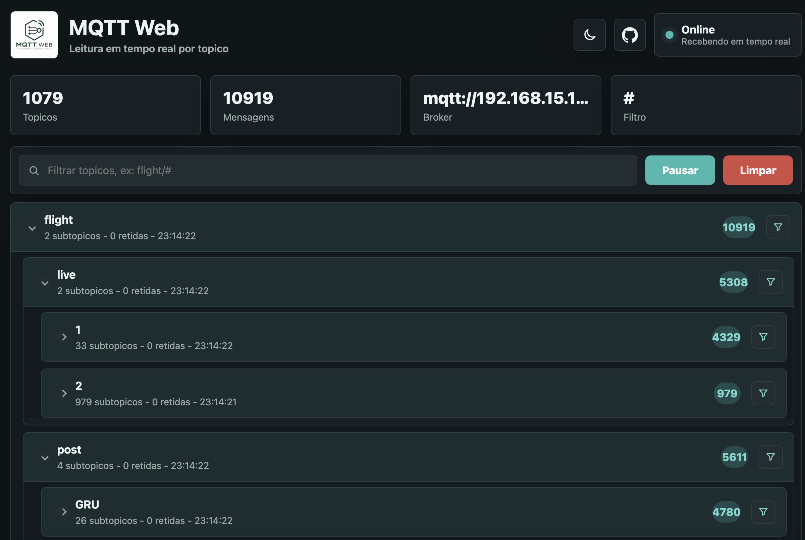

# MQTT Web

[](https://github.com/gustavocaloi/MQTT-Web)
[](https://opensource.org/license/MIT)

Aplicacao web simples para acompanhar mensagens MQTT em tempo real, agrupadas por topico.

## Como funciona



O servidor Node conecta no broker MQTT, assina o filtro raiz configurado e envia as mensagens para a interface via WebSocket. A mesma aplicacao serve a UI e a API, entao o container nao depende de outro componente para subir alem do broker MQTT que voce quer monitorar.

Na interface, os topicos aparecem minimizados em arvore. Quando uma nova mensagem chega, o caminho do topico pulsa visualmente. O clique no ultimo topico abre diretamente o payload, a comparacao com a mensagem anterior e o historico paginado. Topicos com mensagens proprias e subtópicos permitem acessar ambos pelo mesmo clique.

As mensagens de cada topico sao paginadas. O tamanho da pagina e configurado por ambiente e no Compose o padrao esta em 100 mensagens por pagina. Para volumes grandes, os subtopicos tambem sao exibidos em lotes para manter a interface responsiva.

Importante: MQTT nao possui uma consulta universal de historico. A tela mostra mensagens retidas pelo broker e todas as novas mensagens recebidas apos a assinatura.

## Variaveis de ambiente

| Variavel | Padrao | Descricao |
| --- | --- | --- |
| `PORT` | `8080` | Porta HTTP da aplicacao |
| `MQTT_URL` | vazio | URL do broker MQTT; sem URL, a tela abre o popup de configuracao |
| `MQTT_ROOT_FILTER` | `#` | Filtro raiz MQTT usado para assinar e limitar o que pode ser exibido |
| `MQTT_TOPIC` |  | Alias legado para `MQTT_ROOT_FILTER`, usado apenas se `MQTT_ROOT_FILTER` nao estiver definido |
| `MQTT_USERNAME` |  | Usuario MQTT, se necessario |
| `MQTT_PASSWORD` |  | Senha MQTT, se necessario |
| `MQTT_QOS` | `0` | QoS da assinatura |
| `MAX_MESSAGES_PER_TOPIC` | `100` | Quantidade maxima mantida em memoria por topico |
| `MESSAGES_PER_PAGE` | `100` | Quantidade de mensagens exibidas por pagina em cada topico |
| `TOPIC_CHILDREN_PER_PAGE` | `200` | Quantidade de subtopicos renderizados por lote em cada nivel da arvore |
| `MAX_PAYLOAD_PREVIEW` | `65536` | Limite de exibicao do payload por mensagem |

## Rodar localmente

### Conexao pela interface

O botao de configuracao no cabecalho abre o popup com broker, usuario, senha,
filtro raiz e QoS. Sem `MQTT_URL`, o popup abre automaticamente ao acessar a
plataforma. O servidor continua disponivel mesmo sem broker configurado.

As alteracoes valem para todos os navegadores conectados a esta instancia,
apenas ate o processo/container reiniciar. Nenhum arquivo `.env` e alterado e
as credenciais nao sao salvas no navegador. A reinicializacao restaura as
variaveis de ambiente. Aplicar uma conexao limpa o historico em memoria.

A senha atual nao e retornada pela API: o campo vazio a preserva para o mesmo
broker e usuario. O botao de remover senha a limpa explicitamente. Ao trocar
broker ou usuario, informe a senha novamente, se necessaria.

Esta aplicacao nao possui autenticacao de acesso. Restrinja a interface/API a
uma rede confiavel ou a um proxy autenticado; use HTTPS fora do ambiente local.
Quem acessa a instancia pode alterar a conexao compartilhada.

### Desenvolvimento

```bash
npm install
MQTT_URL=mqtt://localhost:1883 npm start
```

Acesse `http://localhost:8080`.

## Rodar em container

```bash
docker build -t mqtt-web .
docker run --rm -p 8080:8080 \
  -e MQTT_URL=mqtt://host.docker.internal:1883 \
  -e MQTT_ROOT_FILTER='#' \
  -e MQTT_USERNAME='' \
  -e MQTT_PASSWORD='' \
  mqtt-web
```

Ou com Compose:

```bash
bash deploy/scripts/deploy-local.sh
```
